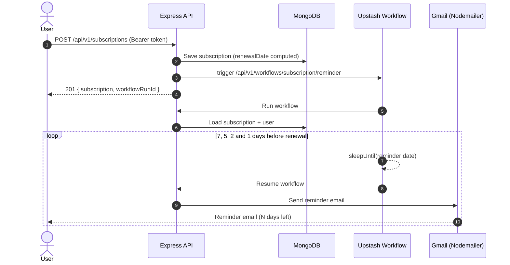

# Subscription Tracker API

[](https://nodejs.org/)
[](https://expressjs.com/)
[](https://mongoosejs.com/)
[](https://upstash.com/docs/workflow)
[](https://arcjet.com/)
[](https://nodemailer.com/)
[](https://jwt.io/)

A REST API for tracking recurring subscriptions. When you add a subscription, the API works out its renewal date and starts an Upstash Workflow that emails you reminders 7, 5, 2 and 1 day before it renews. Requests are protected by Arcjet (attack shield, bot detection and rate limiting) and users sign in with JWT.

## Contents

- [Features](#features)
- [Built with](#built-with)
- [How reminders work](#how-reminders-work)
- [Folder layout](#folder-layout)
- [Running it locally](#running-it-locally)
- [Environment variables](#environment-variables)
- [API](#api)
- [Data models](#data-models)
- [Security](#security)
- [Roadmap](#roadmap)
- [License](#license)

## Features

- Sign up and sign in with email and password (bcrypt hashing, JWT sent as a Bearer token)
- Create subscriptions with price, currency, billing frequency, category and payment method
- Renewal date worked out automatically from the start date and frequency
- Durable reminder workflow on Upstash: it sleeps until each reminder date, so nothing has to keep running on your server
- HTML reminder emails sent through Gmail with Nodemailer
- Arcjet on every request: attack shield, bot detection and a per-IP token bucket rate limit
- One error handler that turns Mongoose errors (bad IDs, duplicate emails, validation) into clean JSON responses

## Built with

Node.js (ES modules), Express 4, MongoDB with Mongoose, JSON Web Tokens, bcryptjs, Upstash Workflow (QStash), Nodemailer, Day.js, Arcjet, ESLint

## How reminders work



1. `POST /api/v1/subscriptions` saves the subscription. If no `renewalDate` is sent, it is set to the start date plus 1, 7, 30 or 365 days depending on `frequency`.
2. The API triggers an Upstash Workflow that calls back to `SERVER_URL/api/v1/workflows/subscription/reminder` with the subscription ID.
3. The workflow loads the subscription. It stops straight away if the subscription isn't `active` or its renewal date has already passed.
4. For each reminder (7, 5, 2 and 1 day before renewal), it sleeps on Upstash until that date, then sends the matching email template.

Because Upstash calls your server back, `SERVER_URL` has to be reachable from the internet. For local development, expose your port with a tunnel such as ngrok, or run the [local QStash dev server](https://upstash.com/docs/workflow/howto/local-development).

## Folder layout

```text
subscription-tracker/
├── app.js                       Express app, middleware and routes
├── config/
│   ├── env.js                   Loads .env.<NODE_ENV>.local
│   ├── arcjet.js                Arcjet rules (shield, bot detection, token bucket)
│   ├── nodemailer.js            Gmail transporter and sender address
│   └── upstash.js               Upstash Workflow client
├── controllers/
│   ├── auth.controller.js       Sign up, sign in, sign out
│   ├── subscription.controller.js   Create subscription, list a user's subscriptions
│   ├── user.controller.js       List users, get one user
│   └── workflow.controller.js   Reminder workflow
├── database/
│   └── mongodb.js               MongoDB connection
├── middleware/
│   ├── arcjet.middleware.js     Runs Arcjet on every request
│   ├── auth.middleware.js       Checks the Bearer token
│   └── error.middleware.js      Turns errors into JSON responses
├── models/
│   ├── user.model.js
│   └── subscription.model.js    Includes the renewal date hook
├── routes/                      auth, users, subscriptions, workflows
└── utils/
    ├── email-template.js        HTML templates for each reminder
    └── send-email.js            Fills in a template and sends it
```

## Running it locally

You'll need Node.js 18 or newer, a MongoDB database, an [Arcjet](https://arcjet.com/) key, an [Upstash](https://upstash.com/) QStash token and a Gmail account with an [app password](https://support.google.com/accounts/answer/185833).

Use MongoDB Atlas or another replica set: sign-up runs inside a MongoDB transaction, and transactions don't work on a standalone local server.

```bash
git clone https://github.com/Navraj86/subscription-tracker.git
cd subscription-tracker
npm install
cp .env.example .env.development.local
```

Fill in `.env.development.local` (see below). Then open `config/nodemailer.js` and set `accountEmail` to the Gmail address that should send the reminders.

```bash
npm run dev     # restarts on file changes
# or
npm start
```

With the example config the API runs on `http://localhost:5500`.

## Environment variables

The app reads `.env.<NODE_ENV>.local`, so you need `.env.development.local` for development and `.env.production.local` for production.

| Variable | What it's for | Example |
| :--- | :--- | :--- |
| `PORT` | Port the server listens on | `5500` |
| `SERVER_URL` | Public URL of this API. Upstash calls the workflow route here. | `http://localhost:5500` |
| `NODE_ENV` | Picks which env file is loaded | `development` |
| `DB_URI` | MongoDB connection string | `mongodb+srv://...` |
| `JWT_SECRET` | Secret used to sign tokens | `a-long-random-string` |
| `JWT_EXPIRES_IN` | How long a token lasts | `1d` |
| `ARCJET_KEY` | Arcjet API key | `ajkey_...` |
| `ARCJET_ENV` | `development` lets Arcjet accept localhost requests | `development` |
| `QSTASH_URL` | QStash URL (or your local dev server URL) | `https://qstash.upstash.io` |
| `QSTASH_TOKEN` | QStash token from the Upstash console | `ey...` |
| `EMAIL_PASSWORD` | Gmail app password for the sender account | `xxxx xxxx xxxx xxxx` |

## API

Base path: `/api/v1`. For routes that need a login, send `Authorization: Bearer <token>`.

### Auth

| Method | Endpoint | Body | Login | Status |
| :--- | :--- | :--- | :---: | :--- |
| `POST` | `/auth/sign-up` | `name`, `email`, `password` | No | Working |
| `POST` | `/auth/sign-in` | `email`, `password` | No | Working |
| `POST` | `/auth/sign-out` | | No | Placeholder |

Sign-up and sign-in return `{ success, message, data: { token, user } }`.

### Subscriptions

| Method | Endpoint | What it does | Login | Status |
| :--- | :--- | :--- | :---: | :--- |
| `POST` | `/subscriptions` | Create a subscription and start its reminder workflow | Yes | Working |
| `GET` | `/subscriptions/user/:id` | All subscriptions for a user (only your own) | Yes | Working |
| `GET` | `/subscriptions` | List all subscriptions | | Placeholder |
| `GET` | `/subscriptions/:id` | Get one subscription | | Placeholder |
| `PUT` | `/subscriptions/:id` | Update a subscription | | Placeholder |
| `DELETE` | `/subscriptions/:id` | Delete a subscription | | Placeholder |
| `PUT` | `/subscriptions/:id/cancel` | Cancel a subscription | | Placeholder |
| `GET` | `/subscriptions/upcoming-renewals` | Upcoming renewals | | Placeholder |

Example body for `POST /subscriptions`:

```json
{
  "name": "Netflix Premium",
  "price": 15.99,
  "currency": "USD",
  "frequency": "monthly",
  "category": "entertainment",
  "paymentMethod": "Credit Card",
  "startDate": "2026-10-01T00:00:00.000Z"
}
```

The response includes the saved subscription and the `workflowRunId` from Upstash.

### Users

| Method | Endpoint | What it does | Login | Status |
| :--- | :--- | :--- | :---: | :--- |
| `GET` | `/users` | List users | No | Working |
| `GET` | `/users/:id` | Get one user (password excluded) | Yes | Working |
| `POST` | `/users` | Create a user | | Placeholder |
| `PUT` | `/users/:id` | Update a user | | Placeholder |
| `DELETE` | `/users` | Delete a user | | Placeholder |

### Workflows

| Method | Endpoint | What it does |
| :--- | :--- | :--- |
| `POST` | `/workflows/subscription/reminder` | Called by Upstash Workflow to run the reminder steps. Not meant to be called directly. |

Placeholder routes respond with a short `{ "title": "..." }` message and don't touch the database yet.

## Data models

### User

| Field | Type | Rules |
| :--- | :--- | :--- |
| `name` | String | Required, 2 to 50 characters |
| `email` | String | Required, unique, lowercased, must look like an email |
| `password` | String | Required, stored as a bcrypt hash |
| `createdAt`, `updatedAt` | Date | Added automatically |

### Subscription

| Field | Type | Rules |
| :--- | :--- | :--- |
| `name` | String | Required, 2 to 100 characters |
| `price` | Number | Required, 0 or more |
| `currency` | String | `USD`, `EUR` or `GBP` (default `USD`) |
| `frequency` | String | `daily`, `weekly`, `monthly` or `yearly` |
| `category` | String | Required: `sports`, `news`, `entertainment`, `lifestyle`, `technology`, `finance`, `politics` or `other` |
| `paymentMethod` | String | Required |
| `status` | String | `active` or `inactive` (default `active`). Set to `expired` when the renewal date has already passed. |
| `startDate` | Date | Required, can't be in the future |
| `renewalDate` | Date | Optional, must be after `startDate`. Worked out from `frequency` if left out. |
| `user` | ObjectId | Required, set from the signed-in user |
| `createdAt`, `updatedAt` | Date | Added automatically |

## Security

- **Arcjet on every request** ([`config/arcjet.js`](config/arcjet.js)), always in `LIVE` mode:
  - `shield` blocks common attacks such as SQL injection and XSS patterns
  - `detectBot` blocks automated clients, except search engines
  - a token bucket per IP: up to 10 requests at once, refilling 5 every 10 seconds
  - Rate-limited requests get `429`, bots and other denials get `403`
- **JWT auth:** protected routes check the Bearer token and load the user from the database
- **Ownership check:** you can only list your own subscriptions
- **Validation:** Mongoose schema rules, with errors returned as `400` JSON responses

## Roadmap

- Implement the placeholder subscription and user routes (get, update, delete, cancel, upcoming renewals)
- Add a sign-out that invalidates tokens
- Require a login on `GET /users` and leave password hashes out of its response
- Register `/upcoming-renewals` before `/:id` so Express doesn't treat it as an ID
- Add `expired` to the subscription `status` values
- Move the sender email address into an environment variable

## License

MIT
